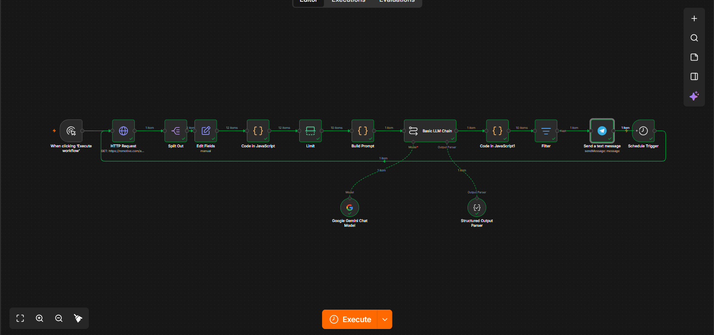

# Job Hunt Automation (n8n + Gemini + Telegram)

An n8n workflow that fetches remote job listings every day, scores each one against my profile using Gemini, and sends only the best matches to my Telegram.

## The problem
Searching for junior AI roles means opening many sites daily and reading dozens of listings, most of which don't fit. This workflow does the filtering for me.

## How it works
1. **Schedule Trigger** runs the workflow once a day.
2. **HTTP Request** fetches jobs from the Remotive API (AI category).
3. **Split Out + Edit Fields** turn the response into one clean item per job.
4. **Filters** drop senior/lead roles and keep relevant titles before spending any AI quota.
5. **Code node** strips HTML from descriptions and trims them.
6. **Build Prompt** batches all jobs into a single request.
7. **Gemini (Basic LLM Chain + Structured Output Parser)** returns a score (1-10), a reason, and missing skills for each job.
8. **Filter** keeps jobs scoring 5 or higher.
9. **Telegram** sends the job title, company, score, reason, and link.
10. A separate **Error Workflow** sends me a Telegram alert if any run fails.

## Tech stack
n8n, Google Gemini API, Telegram Bot API, Remotive API, JavaScript (Code nodes)

## Key design decisions
- **Batching:** the first version sent one AI request per job and hit the free-tier daily limit. Batching all jobs into one structured request fixed that.
- **Pre-filtering before AI:** filtering by title keywords first saves quota and improves results.
- **Structured output:** forcing JSON from the model makes the response easy to filter and route.
- **Error monitoring:** a dedicated error workflow alerts me when a scheduled run fails.

## Setup
1. Install n8n (https://docs.n8n.io) and open it locally.
2. Import both files from `workflows/` (Workflows → Import from file).
3. Create your own credentials: a Gemini API key and a Telegram bot token.
4. Replace `YOUR_CHAT_ID` in both Telegram nodes with your chat ID.
5. Edit the candidate profile inside the Prompt to match yours.
6. Set `job-hunt-error-alert` as the Error Workflow in the main workflow's settings.
7. Activate the workflow.

## Limitations
- Runs locally, so n8n must be running for the schedule to fire. Docker/VPS deployment is a planned improvement.
- Scoring quality depends on the candidate profile written in the prompt.

## Attribution
Job data comes from the [Remotive API](https://remotive.com/api-documentation). Each notification links back to the original Remotive listing. Job listings are not stored or redistributed in this repository.
